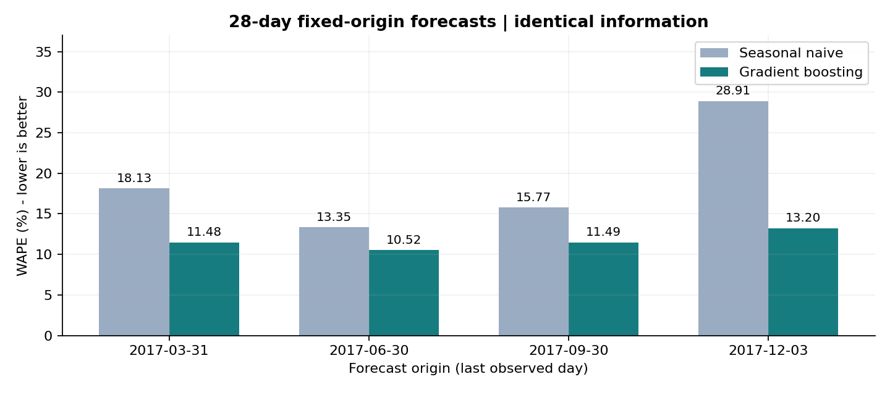
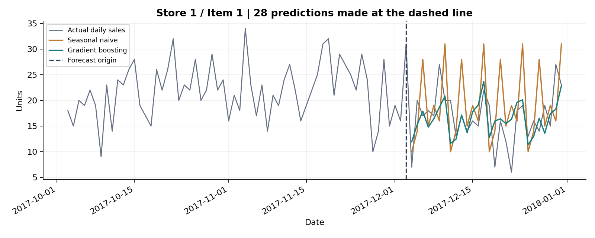
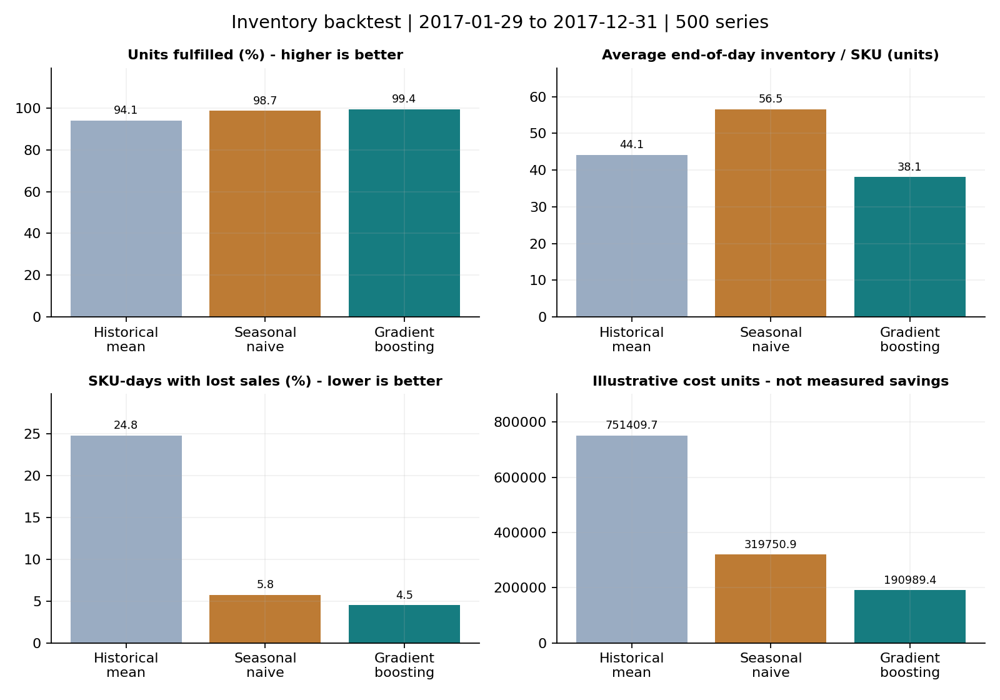
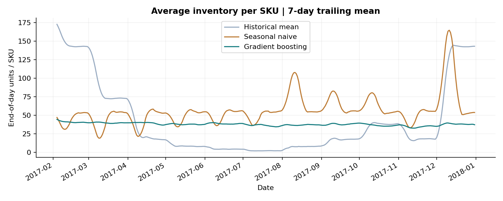
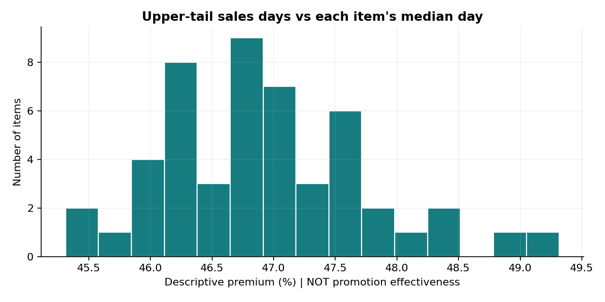

# Retail Demand & Inventory Analytics

**Can better demand forecasts support lower inventory without sacrificing availability?**

A reproducible Python case study connecting fixed-origin sales forecasts to a daily
inventory simulation across **500 store-item series**. The emphasis is on fair
evaluation, explicit assumptions, and decisions supported by inspectable results.

[Quick start](#quick-start-for-first-time-users) · [Use your own data](#use-your-own-data) · [Methodology](docs/methodology.md)

## Results at a glance

| Experiment / metric | Seasonal-naive baseline | Gradient boosting |
|---|---:|---:|
| Pooled WAPE over four 28-day holdouts — lower is better | 18.05% | **11.50%** |
| Inventory unit fill rate — higher is better | 98.73% | **99.39%** |
| Average end-of-day inventory per SKU — units | 56.52 | **38.11** |
| SKU-days with any lost demand — lower is better | 5.76% | **4.52%** |

In the scored inventory simulation, gradient boosting held **32.6% less average
inventory** than the seasonal-naive policy while achieving a higher unit fill rate.
These are retrospective scenario results, not measured store savings or a guarantee
of future performance. The forecasting and inventory experiments have different,
explicitly documented decision schedules.

## Data

[Kaggle — Store Item Demand Forecasting Challenge](https://www.kaggle.com/competitions/demand-forecasting-kernels-only):
913,000 daily records, 10 stores × 50 items, 2013-01-01 through 2017-12-31.

The file contains only `date`, `store`, `item`, and `sales`. It has no observed
inventory, supplier lead times, promotion flags, or prices. Sales are treated as a
proxy for unconstrained demand; raw competition data are not redistributed.

## 1. Forecasting: identical information, multiple time periods

At each origin, fit using history through that date and predict all next 28 days
at once. Both methods recursively use their own predictions when an observed lag
is no longer available. **No holdout actual sales enter either forecast.**

| Last observed day | Holdout ends | Seasonal-naive WAPE | Gradient-boosting WAPE |
|---|---|---:|---:|
| 2017-03-31 | 2017-04-28 | 18.13% | 11.48% |
| 2017-06-30 | 2017-07-28 | 13.35% | 10.52% |
| 2017-09-30 | 2017-10-28 | 15.77% | 11.49% |
| 2017-12-03 | 2017-12-31 | 28.91% | 13.20% |



The pooled WAPE of 11.50% uses the sum of absolute errors divided by the sum of
actual units across all four holdouts (56,000 observations). It is not the mean of
per-SKU percentage errors. The pooled relative error reduction is **36.3%** versus
this baseline; individual periods differ substantially.

The global model is scikit-learn's `HistGradientBoostingRegressor`, using 7/14/28-day
lags, calendar features, and store/item IDs. Parameters are fixed, with random
internal early stopping disabled. These are diagnostic holdouts, not an untouched
final test for a tuned model. See [per-origin results](results/forecast_by_origin.csv),
[per-series results](results/forecast_by_series.csv), and [methodology](docs/methodology.md).



## 2. Inventory: forecasts become replenishment decisions

Compare **historical mean**, **seasonal naive**, and **gradient boosting** in the
same daily-review, seven-day-lead-time, lost-sales simulator.

| Stage | Dates | What is allowed |
|---|---|---|
| Fit | Through 2016-09-30 | Fit the model and historical means |
| Calibrate | 2016-10-01 to 2016-12-31 | Estimate policy-specific forecast-error buffers |
| Warm up | 2017-01-01 to 2017-01-28 | Initialize inventory and replenishment pipeline |
| Score | 2017-01-29 to 2017-12-31 | Measure 337 days × 500 series |

Each morning: receive due orders, forecast the next **8 days** (7 lead-time days
plus 1 review day), order up to forecast demand plus a calibrated buffer, then
fulfill that day's demand. Outstanding orders are counted so inventory is not
ordered twice. Model weights and buffers stay frozen during test; input history
updates only with demand observed through yesterday.

Buffers use the nonnegative **95th percentile of pre-test eight-day forecast
errors**, separately for each policy and SKU. This is a calibration parameter:
**it does not mean 95% service was achieved**, and unit fill rate differs from
cycle service level.

| Policy | Unit fill rate | Average inventory / SKU | Stockout SKU-days |
|---|---:|---:|---:|
| Historical mean | 94.07% | 44.08 units | 24.81% |
| Seasonal naive | 98.73% | 56.52 units | 5.76% |
| Gradient boosting | **99.39%** | **38.11 units** | **4.52%** |




The illustrative cost scenario uses 0.02 per unit of end-of-day stock per day and
1.00 per lost unit, in **scenario cost units, not SGD**. Costs are 319,750.92 for
seasonal naive and 190,989.40 for gradient boosting, a 40.3% scenario reduction.
Gradient boosting has the lowest cost in all nine supplied cost scenarios; the
sensitivity changes cost weights, not the underlying policy decisions.

The simulator assumes unlimited supply, fixed lead time, full observation of
demand, no order/setup costs, no purchase costs, no capacity constraints, and no
shelf-life limits. It is not an optimized or production-ready inventory system.

Evidence: [metrics](results/inventory_metrics.csv),
[daily movements](results/inventory_daily.csv),
[per-SKU outcomes](results/inventory_by_series.csv),
[calibrated buffers](results/inventory_buffers.csv),
[cost sensitivity](results/inventory_cost_sensitivity.csv),
[configuration](results/inventory_config.json).

## 3. High-sales days: description, not promotion effectiveness

The highest approximately 10% of sales days have a median item-level premium of
**46.8%** over the median day. This follows a selection based on sales themselves:
it describes the upper tail, and does **not** identify a promotion or estimate its
causal effect. Ties can change the selected fraction. The former promotion-uplift
naming has been removed.



The separate [normal-demand safety-stock reference](results/safety_stock_top20.csv)
is fitted through 2016-09-30. It is explanatory and is not the policy evaluated by
the inventory backtest.

## Quick start for first-time users

You can inspect the charts and CSVs on GitHub without installing anything. To
regenerate them locally, follow the steps below. No model API key or paid AI
subscription is required.

### 1. Get the project and open its folder

If Git is installed, open Terminal on macOS/Linux or Command Prompt on Windows:

```bash
git clone https://github.com/guvimmine/retail-demand-analytics.git
cd retail-demand-analytics
```

Alternatively, choose **Code → Download ZIP** on this GitHub page, extract the ZIP,
and open a terminal in the extracted `retail-demand-analytics-main` folder. You do
not need Git for this route. Before continuing, check that `README.md`,
`requirements.txt`, and the `src` folder are visible in your current folder.
All commands below run from this **repository root**, not from inside `src`.

### 2. Create an isolated Python environment

For a new setup, use **Python 3.11 or 3.12** from [python.org](https://www.python.org/downloads/).
The examples below use 3.11; substitute `3.12` if that is what you installed.
The published results were produced with Python 3.9.6; exact versions are in the
[run manifest](results/run_manifest.json). The pinned [NumPy release](https://pypi.org/project/numpy/2.0.2/) lists support
for Python 3.9–3.12, so do not assume the newest Python release will install these
older pinned dependencies unchanged.

**macOS / Linux (Terminal):**

```bash
python3.11 --version
python3.11 -m venv .venv
source .venv/bin/activate
python -m pip install -r requirements.txt
```

**Windows (Command Prompt / cmd):**

```bat
py -3.11 --version
py -3.11 -m venv .venv
.venv\Scripts\activate.bat
python -m pip install -r requirements.txt
```

Windows PowerShell users can avoid activation and run
`.\.venv\Scripts\python.exe` in place of `python` in the remaining commands,
including the dependency-install command. No execution-policy change is needed.
If `py` or `python3.11` is unavailable, install the selected Python version and
reopen the terminal. In a new terminal session, activate `.venv` again before running.

### 3. Prepare the competition data

1. Open the [competition Data page](https://www.kaggle.com/competitions/demand-forecasting-kernels-only/data).
   Sign in to Kaggle and accept any required competition rules to download the data.
2. Download and extract **`train.csv`**, which contains the observed `sales` column.
   Do not use `test.csv` or `sample_submission.csv` for these backtests.
3. Create the local data folder from the repository root:

   ```bash
   python -c "from pathlib import Path; Path('data').mkdir(exist_ok=True)"
   ```

4. Copy the extracted `train.csv` into that folder. The layout should be:

   ```text
   retail-demand-analytics/
   ├── README.md
   ├── requirements.txt
   ├── src/
   └── data/
       └── train.csv
   ```

5. Check that the file is in the right place:

   ```bash
   python -c "from pathlib import Path; print(Path('data/train.csv').is_file())"
   ```

   The output should be `True`. Keep the filename `train.csv`, not `train.csv.csv`.
   The `data/` folder is excluded from Git; the raw download stays on your computer.

### 4. Run the analysis and checks

```bash
python -m src.run_all
python -m unittest discover -s tests -v
```

The first command fits four forecast experiments and runs an inventory simulation
for all 500 series. Progress messages include `Forecast holdout` and
`Inventory forecast origins processed`. Runtime depends on your computer; the
first chart may take longer while Matplotlib prepares its fonts. Successful
completion prints `Finished. Reproducibility manifest: .../run_manifest.json`.
The second command runs 14 checks and should finish with `OK`.

Results are written to `results/`; rerunning with the default output replaces the
local result files. To keep the checked-in snapshot and generate a separate run:

```bash
python -m src.run_all --out "data/reproduction_results"
```

This uses the default competition dataset. The original `results/` files remain
the reference evidence used by the artifact checks.

### 5. Read the outputs in this order

| Open first | What to look for |
|---|---|
| `forecast_comparison.png` | Compare WAPE across four time periods; lower is better |
| `forecast_metrics.csv` | Read pooled WAPE and average unit error (MAE) |
| `inventory_comparison.png` | Compare unit fill rate, inventory, stockouts, and scenario cost together |
| `inventory_metrics.csv` | Inspect precise policy-level numbers and the scored dates |
| `forecast_by_series.csv` / `inventory_by_series.csv` | Find weak store-item combinations hidden by overall averages |
| `inventory_daily.csv` | Trace daily arrivals, orders, stock, and lost units |
| `inventory_config.json` / `run_manifest.json` | Confirm the assumptions, data hash, and package versions used |

PNG files open in an image viewer; CSV files can be opened in a spreadsheet app or
text editor. WAPE is a relative error measure, not a classification accuracy.
Unit fill rate is fulfilled units divided by demand units. Average inventory is
an end-of-day quantity per store-item pair. Cost figures use the documented
illustrative weights, not observed revenue or profit.

### Troubleshooting

| Symptom | First thing to check |
|---|---|
| `No module named src` or cannot find `requirements.txt` | Open the terminal in the repository root |
| `No module named pandas` / `sklearn` / `matplotlib` | Activate `.venv`, then use `python -m pip install -r requirements.txt` |
| Dependency installation fails on a newer Python | Recreate the environment with Python 3.11 or 3.12 and the pinned requirements |
| `FileNotFoundError` for `train.csv` | Check `data/train.csv`, ZIP extraction, and hidden filename extensions |
| Missing `sales` column | Use the competition training file, not its test or submission file |
| A date raises `KeyError`, or a full holdout is unavailable | Your file does not cover the configured dates; use the custom-data steps below |
| Duplicate keys / incomplete daily panel | Aggregate genuine transactions and resolve missing days before modeling |
| The first chart appears to pause | Let the font cache finish; follow the progress output rather than opening a second run |

## Use your own data

**Changing `--data` changes only the file path.** The default forecast origins and
inventory dates still refer to 2016–2017. `run_all` is the competition reproduction
entry point; it does not accept custom dates or inventory settings as CLI flags.
For other date ranges, use the existing Python functions as shown below.

### 1. Match the data contract

Save a UTF-8 CSV, for example `data/my_sales.csv`, with these four columns:

```csv
date,store,item,sales
2022-01-01,1,101,12
2022-01-01,1,102,8
2022-01-02,1,101,10
2022-01-02,1,102,9
```

These four rows illustrate the format only; they are not enough to train or test.

| Column / rule | Requirement |
|---|---|
| `date` | Daily business date in `YYYY-MM-DD` form, with no intraday timestamps |
| `store`, `item` | Stable numeric IDs; consistently map text labels to integer IDs before running |
| `sales` | Finite, nonnegative unit quantities; handle returns separately |
| Row granularity | Exactly one row per date × store × item; sum actual separate transactions before exporting |
| Calendar coverage | Every included store-item pair must exist on every calendar date across the same overall range |
| Missing days | Investigate gaps; fill with zero only when zero sales are known, not merely unrecorded |
| History | At least 29 training days per series are needed to form the 28-day lag and fit; seasonal decisions need substantially more history |
| Holdout sales | Every series must have positive total sales in each selected holdout; current per-series WAPE is undefined for an all-zero window |

The loader keeps only these four columns. Extra price or promotion columns do not
automatically become model features. Sales during stockouts may understate demand;
this implementation does not reconstruct that lost demand. New product launches
and intermittent-demand series need additional handling before using this panel design.

### 2. Choose dates before looking at the test results

For forecasting, each origin is the **last observed day**. There must be enough
training history before it and 28 complete actual days after it for scoring.
Choose nonoverlapping evaluation windows when comparing multiple origins.

For inventory, separate **model training → buffer calibration → test** in time.
All configured boundary dates must exist in the CSV. Calibration must contain at
least `lead_time_days + review_days + 1` days to provide two complete error windows;
in practice, use a longer representative period. Test length must exceed
`warmup_days`. The model currently supports daily review only (`review_days = 1`).

The example below assumes complete history from **2022-01-01 to 2024-12-31**.
It trains the inventory model through September 2023, calibrates on the rest of
2023, and tests on 2024. Use dates that match your file rather than copying these
without checking.

### 3. Run the two core experiments with explicit settings

Create **`run_my_data.py` in the repository root**, alongside `README.md`, with:

```python
from pathlib import Path
from src import forecast, inventory_backtest
from src.common import Panel, load_data, output_dir, save_manifest

data = Path("data/my_sales.csv")
out = output_dir("data/my_results")
origins = ["2024-03-31", "2024-06-30", "2024-09-30", "2024-12-03"]
settings = dict(inventory_backtest.SETTINGS)
settings.update({
    "train_end": "2023-09-30",
    "calibration_start": "2023-10-01",
    "calibration_end": "2023-12-31",
    "test_start": "2024-01-01",
    "test_end": "2024-12-31",
    "lead_time_days": 7,
    "review_days": 1,
    "warmup_days": 28,
    "error_quantile": 0.95,
    "holding_cost_per_unit_day": 0.02,
    "lost_sales_penalty_per_unit": 1.0,
})

# Check schema and calendar completeness before fitting anything.
frame = load_data(data)
Panel.from_frame(frame)

forecast.run(data, out, origins=origins)
inventory_backtest.run(data, out, settings=settings)
save_manifest(frame, data, out, {
    "forecast_origins": origins,
    "forecast_horizon_days": 28,
    "model": forecast.MODEL_PARAMS,
    "inventory": settings,
})
print("Saved custom results to", out)
```

Then run, with the same virtual environment active:

```bash
python run_my_data.py
```

This creates forecast and inventory CSVs, charts, and a manifest in
`data/my_results/`. Keeping custom inputs and outputs under the Git-ignored
`data/` directory preserves the published reference results and avoids uploading
business records with an ordinary commit.

If you need only the forecast experiment, the existing CLI also accepts origins:

```bash
python -m src.forecast --data "data/my_sales.csv" --out "data/my_results" --origins 2024-03-31 2024-06-30 2024-09-30 2024-12-03
```

The full custom script uses existing APIs and does not require source-code edits.
Individual module commands remain available for the default competition dates:
`python -m src.forecast`, `python -m src.inventory_backtest`,
`python -m src.safety_stock`, and `python -m src.high_demand`.

### 4. Understand what is configurable and what is fixed

| Setting | How to use it |
|---|---|
| Forecast dates | Change `origins` in your script, or `--origins` for the forecast CLI |
| Training/calibration/test dates | Change the date keys in `settings`; the inventory CLI has no date flags |
| Lead time | Set a positive integer in `lead_time_days`; protection horizon is lead time + one review day |
| Review frequency | Keep `review_days = 1`; weekly review is not implemented |
| Buffer quantile | `error_quantile` must be between 0 and 1; validate achieved service separately |
| Warmup | Choose `warmup_days` shorter than the test and long enough for the replenishment pipeline to settle |
| Main scenario costs | Change the two cost keys; keep units consistent and label any business assumptions |
| Cost-sensitivity grid | The nine weights are currently fixed inside `inventory_backtest.run`; changing the two main cost keys does not change that grid |
| Forecast horizon | The supplied forecast runner scores 28 days; changing it requires code changes |

`inventory_config.json` and `run_manifest.json` in an output folder are **records
of a completed run**, not input configuration files. Editing them does not change
the next run. Put settings in your Python script instead.

The optional `high_demand.run(data, out)` diagnostic also requires a positive median
item-level daily total to calculate a finite upper-tail premium. The optional
`safety_stock.run(data, out, cutoff=settings["train_end"])` reference still assumes
a seven-day lead time and a normal-demand formula; changing inventory settings
does not change that separate reference. These diagnostics are intentionally not
included in the core custom-data example.

### 5. Interpret a custom run as a new experiment

Compare your own baseline, errors, fill rates, inventory, and cost assumptions.
The README's 11.50% WAPE, 99.39% fill rate, and 32.6% inventory reduction belong
only to the published competition experiment. Custom-data checks are not a promise
of the same performance. The 14 repository checks protect program behavior and
reconcile the original `results/` snapshot; they do not validate the business
quality of your new dataset. Review the manifest, results, and limitations before
sharing a new claim, and update the README snapshot only if publishing a separate,
clearly labeled experiment.

## Validation and limitations

- **14 checks** cover recursive lags, invariance to changed future actuals, calendar
  gaps, pooled metrics, arrival timing, outstanding orders, stock conservation,
  lost sales, warmup exclusion, and reconciliation of published results.
- No Kaggle download is needed for the checks. Full experiments require the data.
- Only one public dataset and one inventory test year are evaluated. Calibration
  windows overlap; no confidence intervals or deployment experiment are claimed.
- The data cannot support promotion attribution or observed financial ROI.
- Actual store stockouts would censor sales; that issue cannot be identified here.

[Full methodology, formulas, and references](docs/methodology.md)
